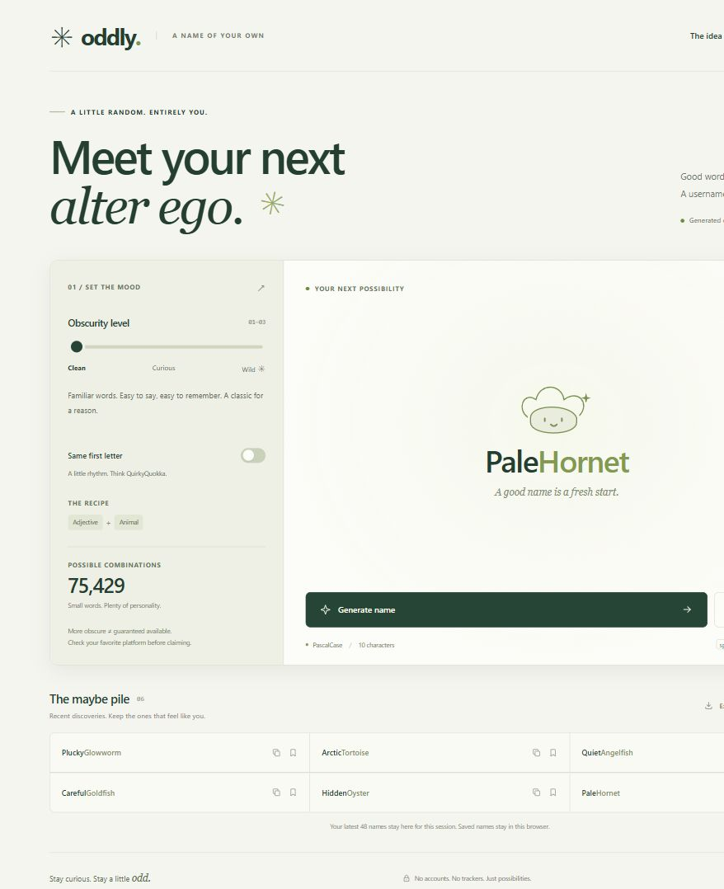

# Oddly ✳

**A name of your own.** A small, private username generator: adjectives, animals, and a little controlled weirdness.

Static HTML, CSS, and native JavaScript modules. No dependencies, accounts, API keys, database, tracking, or external fonts. Ready for GitHub Pages, including project URLs such as `username.github.io/any-repository-name/`.



## Run locally

Install nothing. With Node.js 22 or newer:

```sh
npm start
```

Open **http://127.0.0.1:4173/**. Keep the terminal running while using the preview. Opening `index.html` directly as a `file://` URL is not supported because browsers restrict JavaScript modules there.

```sh
npm test       # Generator, storage recovery, and repository-prefix HTTP tests
npm run check  # JavaScript syntax
npm run build  # Copy only public website files into dist/
```

To preview a GitHub Pages project path locally:

```sh
npm start -- --base=/my-repository/
```

## Publish on GitHub Pages

1. Create an **empty** GitHub repository. Do not initialize it with a README or license; these files are already here.
2. In that repository, open **Settings → Pages → Build and deployment → Source** and choose **GitHub Actions**. If Pages settings appear only after the first push, complete step 3 first, then set the source and rerun the workflow.
3. Push this local Git repository, replacing the URL below with your own:

   ```sh
   git remote add origin https://github.com/YOUR-USERNAME/YOUR-REPOSITORY.git
   git push -u origin main
   ```

   If you downloaded the source without its Git history, run `git init -b main`, `git add .`, and `git commit -m "Create Oddly username generator"` first.

4. The **Test and deploy to GitHub Pages** workflow runs the checks, creates `dist/`, and publishes it. Its deployment summary contains your website URL.

The workflow also checks pull requests without deploying them. No paid services or repository secrets are required. Pages hosting availability depends on your repository visibility and GitHub plan.

Alternative: because the site is buildless, you can remove the workflow and choose **Deploy from a branch → main → / (root)**. `.nojekyll` is already included. The workflow route is preferred because it runs checks and publishes only the public website files.

GitHub references: [publishing source](https://docs.github.com/en/pages/getting-started-with-github-pages/configuring-a-publishing-source-for-your-github-pages-site), [official static-site workflow](https://github.com/actions/starter-workflows/blob/main/pages/static.yml).

## Features

- **Clean:** familiar adjective + animal, e.g. `QuietOtter`.
- **Curious:** two different adjectives + any animal, e.g. `ArcaneMistyQuokka`.
- **Wild:** an invented eight-letter word + uncommon adjective + any animal, e.g. `XyloveneUmbralAxolotl`. Invented words are intentional and are not guaranteed to be real words or free of unintended meanings in every language.
- Instantly switch modes with the obscurity slider or its three labels.
- Optional **Same first letter** switch, off on every page load. All recipe components share their initial: `QuietQuokka` or `MistyMellowMouse`. Applies to individual names and batches at every obscurity level, including the invented word in Wild.
- Names always use ASCII PascalCase; accented animal names are normalized for compatibility.
- Generate one name or a batch of 12; keep the latest 48 in the current session.
- Save up to 100 favorites in this browser, synchronized between tabs of the same origin.
- Copy individual names, export recent names or favorites as plain `.txt` files.
- Keyboard: **Space** generates; **C** copies. Shortcuts do not intercept controls, dialogs, or text editing.
- Responsive layout, labeled controls, native modal focus handling, live announcements, and reduced-motion support.

## Randomness and combination counts

All word choices use `crypto.getRandomValues`, with rejection sampling to avoid modulo bias. The generator skips any name in its last 2,000 results; the protection is shared between modes. Older names can recur. Generation is unlimited in use, but the dictionary combination space is finite.

The UI computes each mode's theoretical word-recipe count from the actual dictionaries, rather than using a hardcoded marketing number:

- Clean: `clean adjectives × clean animals`.
- Curious: `all adjectives × (all adjectives − 1) × all animals`.
- Wild: `prefixes × middles × endings × uncommon adjectives × all animals`.

The included dictionaries provide **75,429 Clean**, **131,357,646 Curious**, and **78,982,881,705 Wild** word recipes.

With **Same first letter** enabled, only matching-initial recipes are eligible. The UI shows the smaller, exact recipe count. Initial letters are weighted by their number of eligible recipes, maintaining uniform recipe selection rather than overrepresenting rare initials. Curious still uses two different adjectives. Repeat protection is shared between normal and alliterative generation.

The invented word uses fixed-width syllables of `3 + 2 + 3` letters. All dictionaries are original curated lists in [src/words.js](src/words.js), editable without a build tool. Word combinations do **not** guarantee platform availability, uniqueness across users, or compliance with every platform's length limit. Higher obscurity makes independent collisions less likely when choices are uniform; the app does not perform availability checks.

## Privacy

Generation, copying, export, and favorites all run in the browser. The app makes no API, analytics, CDN, or third-party font requests. Your hosting provider may still record normal HTTP request metadata. Favorites use the `oddly.saved.v1` localStorage key; recent history stays in memory and disappears when the page reloads. If browser storage is blocked or full, generation still works and favorites are kept only for the current tab. Clearing site data removes stored favorites.

A pseudonym is not an anonymity system. Reusing one across platforms may connect your accounts. Export important favorites before clearing site data.

## Structure

```text
index.html                 Accessible static interface
styles.css                 Responsive interface, no external assets
assets/favicon.svg         Local brand mark
src/words.js               Original dictionaries and invented-word syllables
src/generator.js           Secure randomness, recipes, repeat protection
src/storage.js             Validated, failure-tolerant favorite storage
src/app.js                 UI, clipboard, session history, exports
scripts/                   Dependency-free local server and static packaging
tests/                     Node.js built-in test runner
.github/workflows/pages.yml  Checks and GitHub Pages deployment
```

MIT licensed. Inspired by the adjective–animal naming pattern; no Google or Petname code or dictionaries are used.
